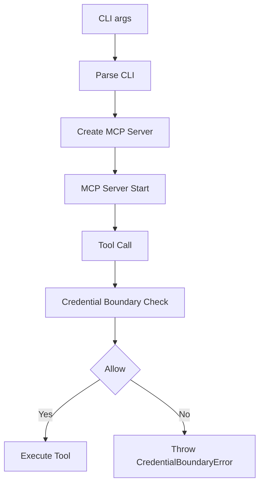

# Skill Documentation

## Tools Reference

This document describes the n8n-mcp-cli MCP tools available in this repository.

### `validate_workflow`
Validate workflow health and risk assessment.

Inputs:
- `workflowId` string
- `executionId` string (optional)

Returns: JSON with health score, failed nodes, bottlenecks, error correlation.

### `get_workflow_health`
Get workflow health score and summary.

Inputs:
- `workflowId` string
- `limit` number (optional, default: 50)

Returns: JSON with health score, status, and recent executions.

### `suggest_nodes`
Suggest compatible nodes for a task (no API calls).

Inputs:
- `workflowId` string
- `taskDescription` string
- `limit` number (optional, default: 5)

Returns: Array of node suggestions with descriptions and compatibility scores.

### `diagnose_workflow`
Full diagnostic analysis including execution traces and error classification.

Inputs:
- `workflowId` string
- `executionId` string
- `config` object (optional, contains trace, classification, regression settings)

Returns: Complete diagnostic report with trace analysis, error classification, and regression detection.

### `get_n8n_version`
Get n8n version information from the instance.

Inputs: None

Returns: JSON with version string and source ("api" or "api-unavailable").

### `create_workflow`
Create a new workflow (placeholder for external mode).

Inputs:
- `workflowData` object (workflow JSON)

Returns: Success message or error if not in external mode.

## Technical capabilities

### Validation
- Workflow health checking with AI-powered failure analysis
- Error classification into categories (infrastructure, permission, data, logic, timeout)
- Confidence scoring for error diagnoses
- Root cause analysis and suggested actions

### Diagnostics
- Execution trace analysis with bottleneck identification
- Node-by-node performance monitoring
- Error correlation across workflow runs
- Regression detection from historical execution data
- Flaky node and performance drift analysis

### Catalog
- Node type catalog search and validation
- Trigger listing and compatibility checking
- Catalog statistics and search functionality
- Node metadata retrieval

### Execution
- Workflow payload execution and result analysis
- Execution history management
- Trace data extraction and analysis
- Performance monitoring and bottleneck detection

## Architecture

### Design constraints

- stdio MCP transport only
- explicit tool surface
- small dependency footprint
- credential boundary (read-only by default, external mode when needed)
- no agentic auto-repair loop

### Components

1. `v2/mcp/server.ts` — MCP server with credential boundary enforcement
2. `v2/core/n8n-client.ts` — n8n API client implementation
3. `v2/diagnostics/diagnose.ts` — workflow diagnosis and analysis
4. `v2/diagnostics/trace-analyzer.ts` — execution trace analysis
5. `v2/diagnostics/failure-classifier.ts` — error classification
6. `v2/diagnostics/regression-detector.ts` — regression detection
7. `v2/cli/commands.ts` — CLI command implementation
8. `v2/core/errors.ts` — error classes and boundary error handling

### Workflow



## Credential Boundary

The credential boundary controls how tools handle authentication credentials and enforces least-privilege access patterns.

### Modes

- **`read-only`** (default): Only read operations allowed
- **`external`**: All operations allowed (requires credentials)

### Tool permissions

| Tool | read-only | external |
|------|-----------|----------|
| `validate_workflow` | ✅ | ✅ |
| `get_workflow_health` | ✅ | ✅ |
| `suggest_nodes` | ✅ | ✅ |
| `diagnose_workflow` | ✅ | ✅ |
| `get_n8n_version` | ✅ | ✅ |
| `create_workflow` | ❌ | ✅ |

### Security practices

- Never log credentials
- Use read-only by default
- External mode only when needed
- Validate environment early

## Testing

### Unit tests
```bash
npm test -- v2/mcp/__tests__/credential-boundary.test.ts
npm test -- v2/cli/__tests__/credential-mode.test.ts
npm test -- v2/core/__tests__/errors.test.ts
npm test -- v2/diagnostics/__tests__/trace-analyzer.test.ts
```

### Integration tests
```bash
npm test -- v2/mcp/__tests__/integration.test.ts
```

## CLI usage

```bash
# Start MCP server in read-only mode (default)
n8n-mcp-cli mcp

# Start MCP server in external mode
n8n-mcp-cli mcp --credential-mode=external

# Help
n8n-mcp-cli --help
```

## Examples

### Workflow validation
```json
{
  "tool": "validate_workflow",
  "parameters": {
    "workflowId": "123",
    "executionId": "456"
  }
}
```

### Workflow health
```json
{
  "tool": "get_workflow_health",
  "parameters": {
    "workflowId": "123",
    "limit": 100
  }
}
```

### Node suggestions
```json
{
  "tool": "suggest_nodes",
  "parameters": {
    "workflowId": "123",
    "taskDescription": "Process data from API and save to database",
    "limit": 10
  }
}
```

### Workflow diagnosis
```json
{
  "tool": "diagnose_workflow",
  "parameters": {
    "workflowId": "123",
    "executionId": "456",
    "config": {
      "trace": { "enabled": true },
      "classify": { "enabled": true },
      "regression": { "enabled": true }
    }
  }
}
```

## Future enhancements

1. **Catalog**: Complete node catalog with search and validation
2. **Execution traces**: Detailed execution history with timing data
3. **Performance monitoring**: Real-time performance metrics and alerts
4. **Regression analysis**: Advanced regression detection and prediction
5. **Multi-workflow support**: Batch operations and workflows management

## Related files

| File | Purpose |
|------|---------|
| `v2/mcp/server.ts` | MCP server implementation |
| `v2/cli/commands.ts` | CLI commands |
| `v2/core/errors.ts` | Error classes |
| `v2/diagnostics/diagnose.ts` | Workflow diagnosis |
| `v2/mcp/__tests__/credential-boundary.test.ts` | Credential boundary tests |
| `v2/cli/__tests__/credential-mode.test.ts` | CLI mode tests |
| `v2/core/__tests__/errors.test.ts` | Error class tests |